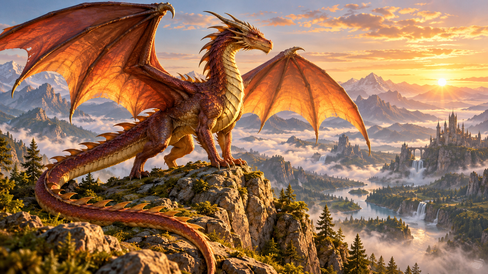

# Bestiario de dragones

## Un viaje entre escamas, fuego y leyendas

Los **dragones** protagonizan historias llenas de misterio y aventuras. En este *bestiario fantástico* exploraremos tres especies inventadas, sus territorios y sus habilidades. Cada criatura tendrá un identificador, como `DRG-001`, para organizar su ficha y construir nuestro propio mundo de fantasía.

*Ilustración de fantasía generada con IA para esta práctica y guardada como imagen local en el repositorio.*

## El mundo del bestiario

Imagina una región donde los volcanes, las montañas heladas y los bosques antiguos esconden criaturas extraordinarias. Los exploradores llaman a estas tierras **El Reino de las Escamas**. Este escenario y sus especies son una creación para la práctica.

Cada dragón posee un elemento dominante que influye en su aspecto y su comportamiento. Para conocer las fichas completas, consulta la [guía de especies y leyendas](docs/detalles.md).

## Rasgos de nuestros dragones

- Escamas resistentes que protegen su cuerpo.
- Alas capaces de recorrer grandes distancias.
- Un aliento mágico relacionado con su elemento.
- Una memoria que conserva antiguos relatos del reino.
- Un territorio que cada especie protege a su manera.

## Cómo registrar un avistamiento

1. Observar al dragón desde una distancia segura dentro de la historia.
2. Anotar el color de sus escamas y la forma de sus alas.
3. Identificar el territorio y las señales de su elemento.
4. Comparar la descripción con la tabla del bestiario.
5. Añadir una ficha con su nombre, identificador y habilidades.

## Especies del Reino de las Escamas

Las siguientes categorías pertenecen a nuestro mundo inventado.

| Especie | Elemento | Hábitat | Habilidad principal |
| --- | --- | --- | --- |
| Dragón de fuego | Fuego | Volcanes y cuevas cálidas | Expulsar llamaradas |
| Dragón de hielo | Hielo | Cumbres nevadas | Crear una niebla congelante |
| Dragón del bosque | Naturaleza | Bosques antiguos | Ocultarse entre la vegetación |

## logo del clara

